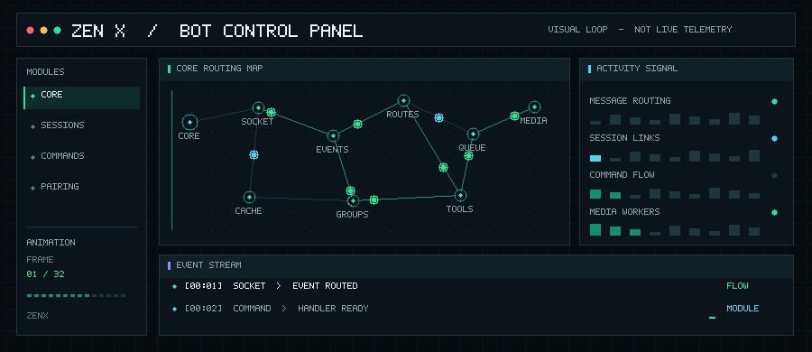
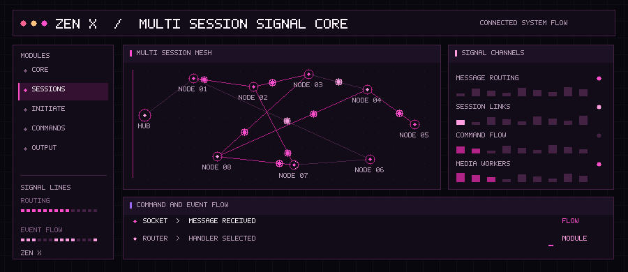
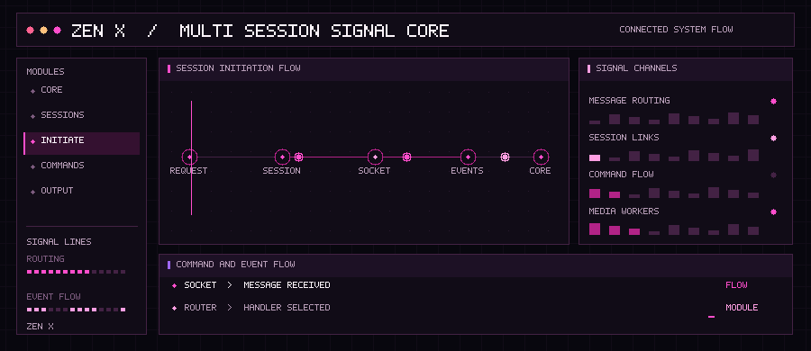
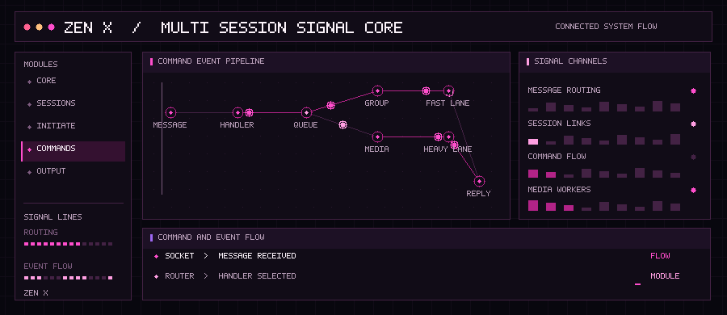
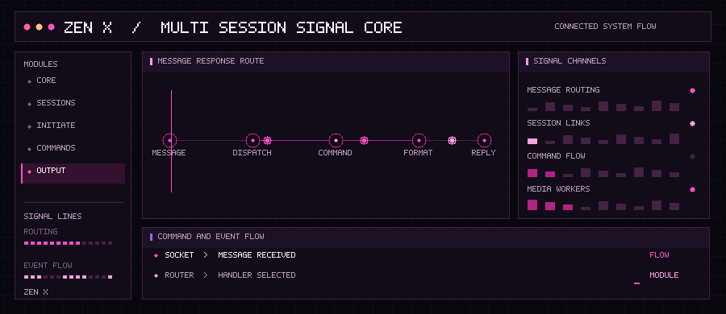

  <h1>ZEN X · MULTI-WHATSAPP SYSTEM</h1>
  
<strong>Connected sessions · shared command core · coordinated responses</strong>

  

## Connected session network

  

## Session initiation

  

## Command routing

  

## Message output

  

  <strong>ZEN X · CONNECTED SYSTEM FLOW</strong>

