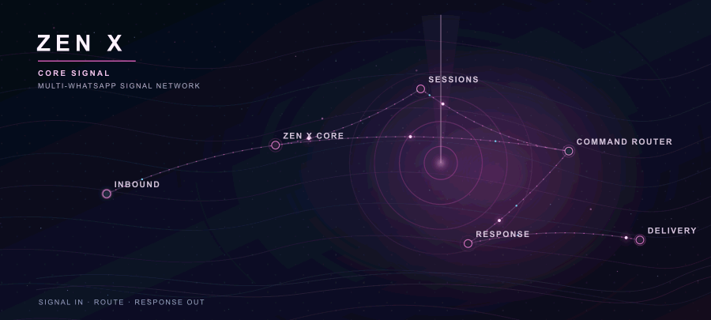
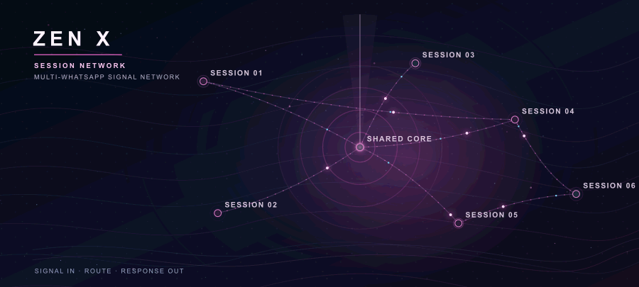
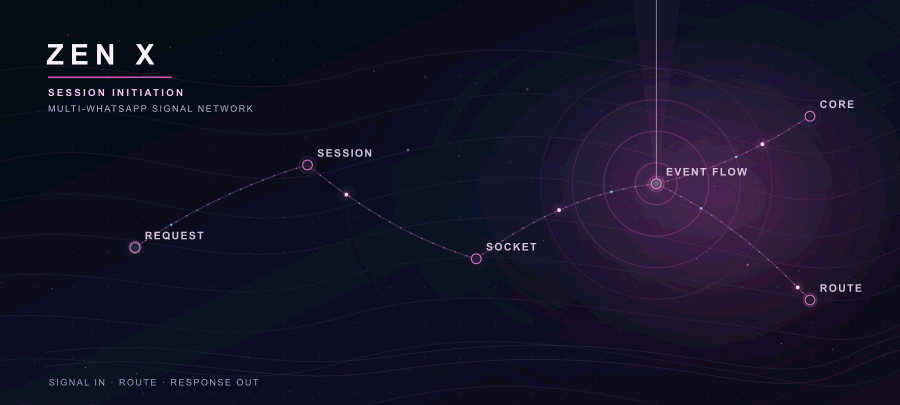
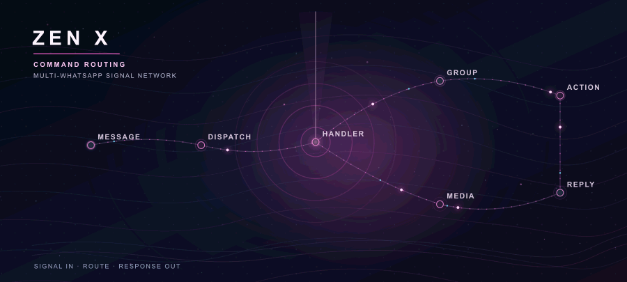
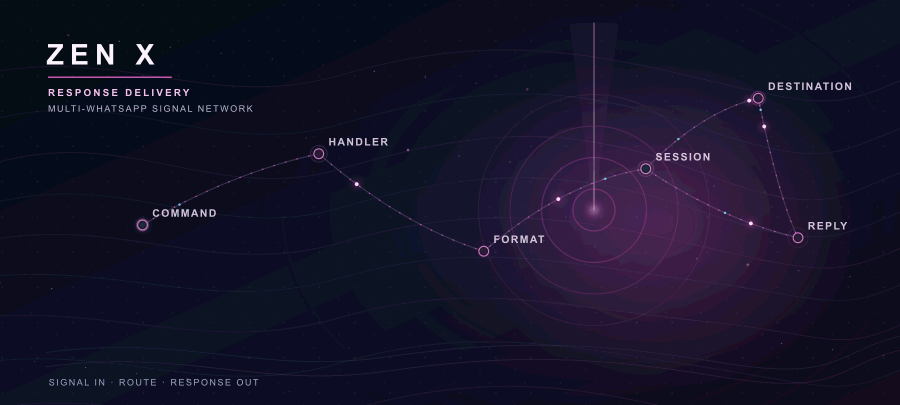

  <h1>ZEN X</h1>
  
<strong>A coordinated multi-session WhatsApp system</strong> One shared core. Connected sessions. Signals moving end to end.

  

## Connected network

Sessions connect to one shared core, with signals moving across the network as messages arrive and responses travel back out.

  

## Session flow

The connection path moves from session request through socket and event flow into the core.

  

## Command routing

Incoming messages travel through dispatch to the relevant command path, including group and media handling.

  

## Response delivery

After command handling, the response moves through formatting and the connected session toward its destination.

  

  <strong>ZEN X · SIGNAL IN · ROUTE · RESPONSE OUT</strong>

