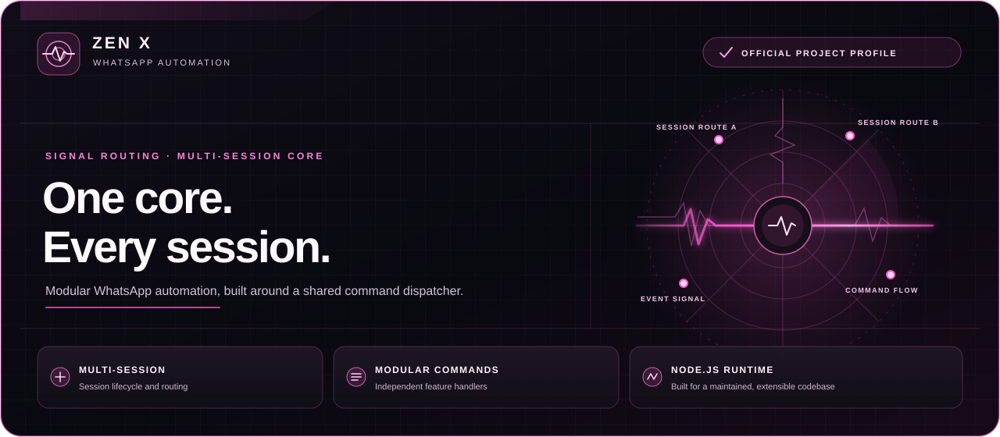

  
  
<strong>Multi-session WhatsApp automation · modular commands · Node.js</strong>

ZenX is a Baileys-based WhatsApp automation project with session management and a modular command system. Its command handlers and connection code are organized into separate modules so features can be maintained independently.

> The panel is a static project illustration. It does not show live sessions or server status.

## System layout

| Component | Purpose |
| --- | --- |
| Session manager | Handles WhatsApp session lifecycle and reconnects. |
| Command dispatcher | Routes prefixed messages to matching command handlers. |
| Modular commands | Keeps bot features in separate files under [`commands/`](commands/). |
| Runtime | Uses Node.js 18 or newer. |

## Command categories

The bot menu groups commands into general, owner, group administration, downloads, fun, AI, utility, media, settings, and system categories. See [`COMMAND_PERFORMANCE.md`](COMMAND_PERFORMANCE.md) for handler conventions and guidance on keeping resource-intensive media work from blocking ordinary commands.

## Run ZenX

1. Install Node.js 18 or newer.
2. Clone this repository and enter its folder.
3. Install dependencies with `npm install`.
4. Configure the environment and WhatsApp session or pairing flow required by your deployment.
5. Start the bot with `npm start`.

Keep WhatsApp session credentials and API keys private. Only connect accounts and groups you own or are authorized to manage.

  <a href="https://github.com/charlescoding300-beep/Cyber-x">Source repository</a> ·
  <a href="https://github.com/charlescoding300-beep/Cyber-x/issues">Report an issue</a> ·
  <a href="https://t.me/yanshbot_bot">Telegram</a>
    
  <strong>Built and maintained by Charles Chuks Tech</strong>

