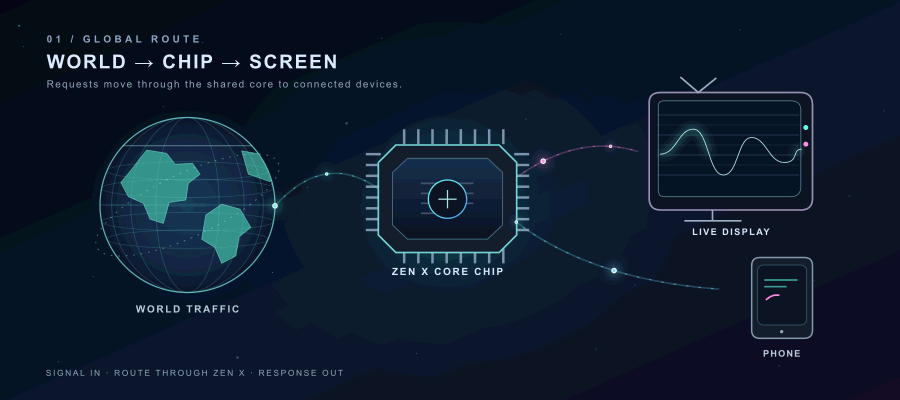
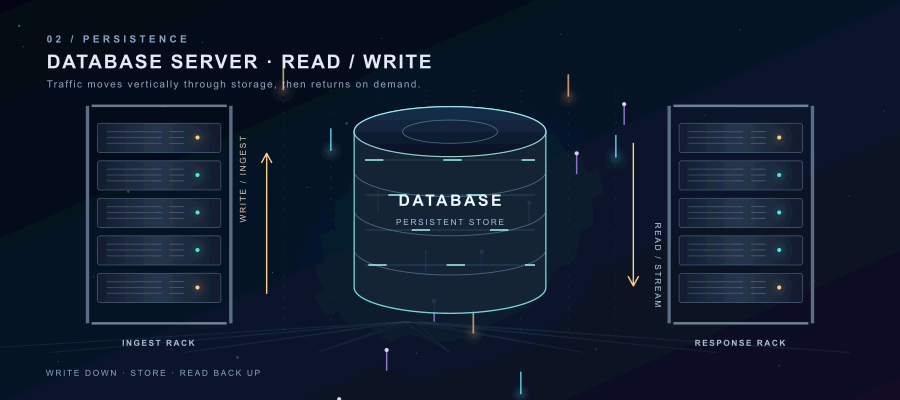
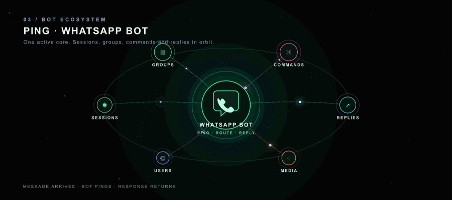

  <h1>ZEN X</h1>
  
<strong>WhatsApp traffic, in motion</strong> A request crosses the network, reaches the shared core and data store, then returns to a connected phone.

## 01 · Global signal path

Messages enter from the online world, pass through the Zen X core, and reach the screen or phone connected to that session. The return path carries the response back out.

  

## 02 · Database traffic

The data layer shows writes moving down into persistent storage and reads streaming back up through the server racks.

  

## 03 · WhatsApp bot ecosystem

At the center is the WhatsApp bot ping: sessions, groups, commands, media, users, and replies orbit one connected message flow.

  

  <strong>ZEN X · REQUEST IN · ROUTE THROUGH · RESPONSE OUT</strong>
   Produced by <a href="https://github.com/charlescoding300-beep">Charles</a>
   © 𓃦 𝗭Ξ𝗡 𝗫_𝗕𝗼𝘁 𓃦

