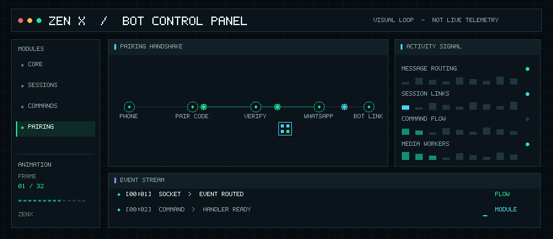

  <h1>⚡ ZenX WhatsApp Bot</h1>
  
<strong>Multi-session automation · modular commands · Node.js</strong>

  
  
<em>Purpose-built looping artwork for this README; it is not live server telemetry.</em>

ZenX is a Baileys-based WhatsApp automation project with session management and a modular command system. The repository groups bot features into small handlers so commands and connection code can be maintained separately.

## Architecture and sessions

  

The project includes session lifecycle management, a shared command dispatcher, and separate modules for WhatsApp events and bot features. The animation is a visual overview of those moving parts, not a live view of connected accounts.

## Command categories

  

Command modules are kept in [`commands/`](commands/). The bot menu organizes them into general, owner, group administration, downloads, fun, AI, utility, media, settings, and system categories. See [`COMMAND_PERFORMANCE.md`](COMMAND_PERFORMANCE.md) for the handler conventions and guidance for keeping expensive media work from blocking ordinary commands.

## Run ZenX

  

1. Install Node.js 18 or newer.
2. Clone this repository and enter its folder.
3. Install dependencies with `npm install`.
4. Configure the environment and WhatsApp session or pairing flow required by your deployment.
5. Start the bot with `npm start`.

Keep WhatsApp session credentials and API keys private. Only connect accounts and groups you own or are authorized to manage.

  <a href="https://github.com/charlescoding300-beep/Cyber-x">Source repository</a> ·
  <a href="https://github.com/charlescoding300-beep/Cyber-x/issues">Report an issue</a> ·
  <a href="https://t.me/yanshbot_bot">Telegram</a>
    
  <strong>Built and maintained by Charles Chuks Tech</strong>

